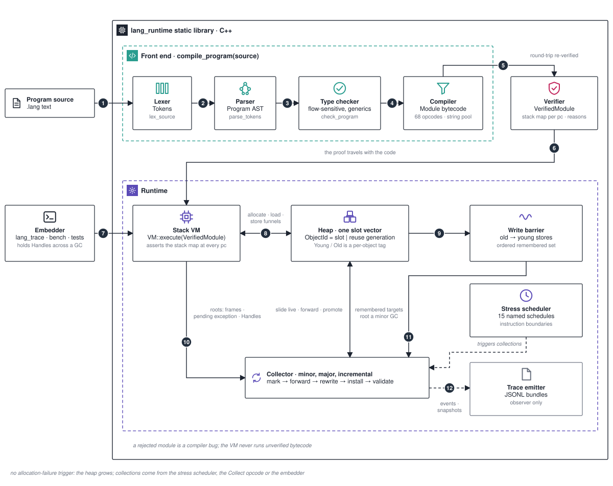

# Architecture

A correctness-first implementation of a small statically typed language. Source passes through a lexer, recursive-descent parser, flow-sensitive type checker, bytecode compiler, verifier, and stack VM. The runtime uses a precise moving, two-generation mark-compact collector with deterministic stress scheduling.

This page is the map: the stages, how a program travels from source to execution, what a collection does, and where the guarantees are checked. The numbers on the diagram match the list below. The full account of each phase, the verifier's join lattice and the protected invariants are in [`../ARCHITECTURE.md`](../ARCHITECTURE.md) and [`../INVARIANTS.md`](../INVARIANTS.md).



## From source to execution

1. **Source → lexer.** `compile_program(source)` starts with `lex_source`. A lexical problem is a diagnostic, never a crash.
2. **Lexer → parser.** `parse_tokens` builds the `Program` AST: function, record, variant and type declarations, type specs, expressions and statements.
3. **Parser → type checker.** `check_program` types the program flow-sensitively (nil refinement included) and monomorphizes generics on demand, with an instantiation depth guard of 32. No type variable survives this stage.
4. **Type checker → compiler.** `compile_checked_program` emits a `Module`: function 0 is `<entry>`, plus layouts, a string pool and per-pc source positions. The instruction set has 68 opcodes and is append-only.
5. **Compiler → verifier.** `verify_module_with_diagnostics` runs a worklist dataflow over an abstract state and attaches a `StackMap` to every pc, then wraps the result as an immutable `VerifiedModule`. The compiler re-verifies its own output and asserts: a rejection here is a compiler bug.
6. **Verifier → VM.** `CompileResult.verified_module` is the only success product. `VM::execute(const VerifiedModule&)` reuses the proof; the raw `Module` and `Function` overloads re-verify first. The VM never runs unverified bytecode.
7. **Embedder → VM.** `lang_trace`, `lang_bench` and the tests drive the VM. C++ code that holds an object reference across a collection must do so through a `gc::Handle`.
8. **VM ↔ heap.** At every instruction boundary the VM asserts the live stack against the stack map, gives the stress scheduler a chance to collect, then dispatches. All allocation and all reference stores go through `Heap` funnels (`store_pair_field`, `store_ref_array_element`, `store_record_field`, `store_map_entry`, `store_ephemeron_value`).
9. **Heap → write barrier.** The heap is one slot vector of objects; an `ObjectId` is a slot index plus a slot-reuse generation in its high bits, so a stale id traps instead of aliasing. `Young` and `Old` are per-object tags on that one vector, not separate memory regions. A store of a young reference into an old object appends the owner to an ordered remembered set.
10. **VM → collector (roots).** Roots are the frames and any pending exception (`VM::trace_roots`), the `Handle` slots, and extra roots registered during allocation.
11. **Write barrier → collector.** For a minor collection the young targets of the remembered set are roots too, so the old generation is never scanned.
12. **Collector → trace emitter.** An observer-only `TraceSink` writes JSONL bundles of events and snapshots. `lang_trace <program.lang> --schedule <name> --out <dir>` produces them; a Python checker verifies conservation across a bundle.

## What a collection does

A minor collection (`Heap::collect_minor`):

1. Finishes any incremental phase that is in progress and validates the registries.
2. Collects roots: frames and the pending exception, `Handle`s, extra roots, and the young targets of the remembered set.
3. Marks young objects only, running the ephemeron fixpoint.
4. Compacts: live objects (old, or young and marked) slide into the lowest slots; every young survivor becomes `Old` on its first survival; dead young objects fire `on_die`.
5. Rewrites roots and descriptor fields through the forwarding table, rewrites the remembered set, and processes weak references, the intern table and ephemerons.
6. Installs the new layout, records promoted edges, prunes the remembered set, validates the heap, and resumes.

A major collection (`Heap::collect`) is the same pipeline over the whole heap without the remembered set. Incremental marking and compaction run the same phases under integer step budgets (`start_incremental_marking`, `incremental_mark_step`, `finish_incremental_marking`, `incremental_compact_step`, `finish_incremental_compaction`).

There is no allocation-failure trigger: `allocate_object` grows the slot vector. Collections come from the stress scheduler (`collect_before_every_allocation`, `collect_after_every_allocation`, `collect_every_n_instructions`, `collect_minor_every_n_instructions`, `collect_minor_after_every_write_barrier`, and the incremental budgets), from the bytecode `Collect` opcode (never emitted by the source compiler), or from the embedder.

## Components

| Component | Responsibility | Where to look |
| --- | --- | --- |
| Lexer | Source to tokens or diagnostics | `src/frontend/lexer.*` |
| Parser | Tokens to `Program` | `src/frontend/parser.*` |
| Type checker and monomorphizer | Flow-sensitive typing, generics instantiated in place | `src/frontend/type_checker_internal.cpp`, `src/frontend/generics.cpp` |
| Compiler | Typed AST to `Module` | `src/frontend/compiler.cpp` |
| Verifier | Dataflow over abstract states, stack maps, `VerifierReason` catalog, `VerifiedModule` | `src/bytecode.cpp`, `include/lang/bytecode.hpp` |
| VM | Frames, roots, stack-map assertions, stress hook, dispatch; depth limit 1024, output cap 1 MiB | `src/vm.cpp`, `include/lang/vm.hpp` |
| Heap | Slot vector, eleven object kinds, generation tags, barriers, remembered set, weak and intern and ephemeron registries, collectors | `src/gc/heap.cpp`, `include/lang/gc/heap.hpp` |
| Trace emitter | JSONL bundles, `lang_trace`, conservation checker | `src/trace.cpp`, `src/tools/lang_trace.cpp`, `SCHEMA.md`, `showcase/` |
| Benchmarks, tests, fuzzing | `lang_bench` with 14 workloads; C++ and Python-driven CTest targets including GC-timing fuzzers; libFuzzer target `verify_fuzz` | `src/bench.cpp`, `tests/`, `fuzz/` |

Everything is one static library, `lang_runtime`, with public headers `include/lang/{bytecode,value,vm,trace,runtime_diagnostics}.hpp`, `include/lang/gc/heap.hpp` and `include/lang/frontend/type_checker.hpp`.

## Boundaries

- **What the verifier guarantees before anything runs.** Stack depth, definite initialisation of locals, jump targets, call arity and kinds, return kind, join consistency (`Poison` for disagreement), exact per-pc reference bits for operands and locals, layout indices, and the shape of `TailCall`.
- **Trusted versus checked.** Source bytes are fully checked; the fuzz contract is a diagnostic, never a crash. The VM trusts a `VerifiedModule` and re-verifies raw bytecode at `execute`. The heap trusts module layouts but validates every collection.
- **Where data lives.** All objects are in the heap-owned slot vector; there are no host pointers into it. The registries (`remembered_set_`, `weak_refs_`, `intern_table_`, `ephemerons_`, `handle_roots_`) live beside it. The VM's output buffer and last trap trace are copied bytes, not roots.
- **Object kinds.** `Pair`, `ScalarArray`, `RefArray`, `Str`, `Closure`, `Map`, `WeakRef`, `Record`, `Variant`, `Ephemeron`, `Builder`.

## What is checked, and where

| Claim | Evidence |
| --- | --- |
| Precise, moving, two-generation collection with the phases mark, forward, rewrite-strong, process-weak, install, validate | `ARCHITECTURE.md`, `INVARIANTS.md`, `tests/iteration3_movement.cpp`, `tests/iteration4_generational.cpp` |
| Verified bytecode: the reason catalogue and the compiler's round-trip assertion | `src/bytecode.cpp`, `src/frontend/compiler.cpp` |
| Deterministic stress: fifteen named schedules (`no_stress` to `combined_mark_compact`); 24 corpora, 115 mutation forms, 2,806 rejection checks with pinned hashes | [`gc-stress-mode.md`](./gc-stress-mode.md), `README.md` |
| Trace conservation on four measured bundles (90 snapshots, 86 replays, 21,369 events) | `showcase/`, `SCHEMA.md` |
| Performance baseline on a Debug, assertions-enabled Apple Clang host, informational only | [`perf-baseline.md`](./perf-baseline.md) |
| Fuzzing: `verify_fuzz` covers the front end and verifier; CI replays the committed corpus as a gate and runs a 90 s discovery pass as advisory, on Ubuntu and macOS with Clang ASan and UBSan | `.github/workflows/ci.yml`, `fuzz/` |

The trace bundles are evidence of conservation, not a cryptographic attestation; `SCHEMA.md` says so. Nothing in the repository claims a JIT, a REPL, Unicode strings, map deletion or finalizers.

## Building and running

```
cmake -S . -B build
cmake --build build
ctest --test-dir build --output-on-failure
```

CTest needs Python 3.9 or newer for the Python-driven targets. `lang_bench --bench NAME --repetitions N` runs one workload; `--counters-only` and `--smoke` shorten it.
